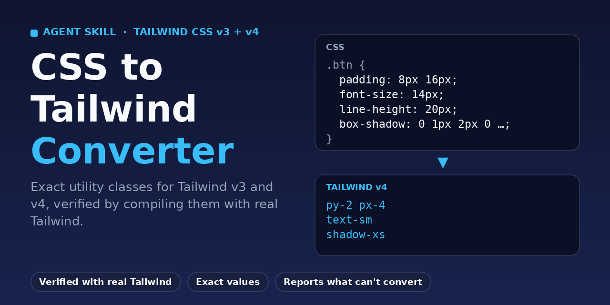

# CSS to Tailwind Converter: AI Agent Skill for Tailwind CSS v3 and v4



[](https://github.com/sabrysuleiman/css-to-tailwind-converter/actions/workflows/ci.yml)
[](LICENSE)
[](#tailwind-v3-vs-v4-at-a-glance)
[](skills/css-to-tailwind/SKILL.md)

**Convert CSS to Tailwind CSS utility classes that render the same, and find out where they can't.**
`css-to-tailwind` is an Agent Skill (`SKILL.md`) for AI agents such as Claude. Give it a declaration, a rule, a
whole stylesheet or inline styles and it returns Tailwind classes grouped per selector, with hover, focus,
responsive and dark-mode variants, `!important`, prefixes and exact arbitrary values, written for **Tailwind v3 or
v4**. It can then compile the result with the real `tailwindcss` package, so you do not have to trust a guess.

> This is a skill for an AI agent plus two helper scripts, not a standalone command-line converter. The agent does
> the mapping; the scripts parse CSS reliably and verify the classes.

## Contents

- [Why use it](#why-use-it)
- [Example: CSS to Tailwind](#example-css-to-tailwind)
- [Install](#install)
- [Usage](#usage)
- [Verify conversions with real Tailwind](#verify-conversions-with-real-tailwind)
- [Tailwind v3 vs v4 at a glance](#tailwind-v3-vs-v4-at-a-glance)
- [What it will not turn into classes](#what-it-will-not-turn-into-classes)
- [FAQ](#faq)
- [Repository layout](#repository-layout)
- [Development and tests](#development-and-tests)
- [Contributing](#contributing)
- [License](#license)
- [Reference](#reference)

## Why use it

Most CSS to Tailwind converters round values to the nearest token and quietly drop what they cannot handle. This
skill is built around fidelity:

| Problem in typical converters | What this skill does |
|---|---|
| Same class, different meaning in Tailwind v3 and v4 (`shadow-sm`, `rounded`, `outline-none`, `ring`) | Detects the target version and emits the right names, `!important` position and prefix position |
| `text-lg` also sets `line-height`; `ease-in-out` is not the CSS keyword; `margin: 0 auto` also zeroes vertical margins | Uses a named utility only when it emits exactly the source CSS, otherwise an arbitrary value such as `text-[18px]` |
| Values rounded to the scale (`13px` becomes `3`) | Keeps them exact: `mt-[13px]` |
| `@font-face`, `@keyframes`, data URLs, broken input make the tool fail or vanish silently | Converts the rest and reports each unsupported construct with what to do about it |
| Descendant selectors, `:hover::after`, media queries lose context | Maps selectors to variants and explains scoping choices |
| No way to check the output | Compiles the classes with real Tailwind and diffs the generated CSS against your CSS |

## Example: CSS to Tailwind

Input (no version stated, so Tailwind v4 is assumed and said out loud):

```css
.btn {
  display: inline-flex; align-items: center; gap: 8px;
  padding: 10px 20px; font-size: 14px; line-height: 20px; font-weight: 600;
  color: #fff; background-color: #2563eb;
  border: 1px solid transparent; border-radius: 6px;
  box-shadow: 0 1px 2px 0 rgb(0 0 0 / 0.05);
  transition: background-color 150ms cubic-bezier(0.4, 0, 0.2, 1);
}
.btn:hover { background-color: #1d4ed8; }
.btn:focus-visible { outline: 2px solid #93c5fd; outline-offset: 2px; }
@media (min-width: 768px) { .btn { padding: 12px 24px; } }
```

Output:

```text
.btn
inline-flex items-center gap-2 py-2.5 px-5 text-sm font-semibold text-white bg-[#2563eb] border border-solid border-transparent rounded-md shadow-xs transition-[background-color] duration-150 ease-in-out hover:bg-[#1d4ed8] focus-visible:outline-2 focus-visible:outline-[#93c5fd] focus-visible:outline-offset-2 md:py-3 md:px-6
```

Notes the skill adds:

- `text-sm` is exact here because it sets both `font-size: 14px` and the `line-height: 20px` the source declares.
- Colors stay arbitrary hex because Tailwind v4's palette is oklch and renders slightly differently.
- `transition-[background-color]` keeps the transition to the one property in the source.
- Tailwind v4 applies `hover:` only on hover-capable devices; CSS `:hover` also fires on touch.

More verified examples (Tailwind v3 with a prefix and `!important`, unsupported at-rules, off-scale values and
transform order) are in [`skills/css-to-tailwind/references/examples.md`](skills/css-to-tailwind/references/examples.md).

## Install

The skill is the folder [`skills/css-to-tailwind`](skills/css-to-tailwind). Install it where your agent loads skills.

**Claude (Claude.ai and the Claude apps).** Download `css-to-tailwind.zip` from the
[Releases](../../releases) page and upload it in Claude's Skills settings.

**Claude Code.**

```bash
git clone https://github.com/sabrysuleiman/css-to-tailwind-converter.git
mkdir -p ~/.claude/skills
cp -r css-to-tailwind-converter/skills/css-to-tailwind ~/.claude/skills/
```

For a single project, copy it to `.claude/skills/` inside that project instead.

**Codex and other agents that read `SKILL.md`.** Copy `skills/css-to-tailwind` into the agent's skills directory
(for Codex this is usually `~/.codex/skills`). The folder includes `agents/openai.yaml` for loaders that read it.

## Usage

Ask in plain language. The skill activates on requests to convert, translate, migrate or check CSS as Tailwind:

```text
Convert this CSS to Tailwind classes: <paste CSS>
Migrate this stylesheet to Tailwind v4 and tell me what can't be converted.
We're on Tailwind 3 with prefix tw-. Convert these rules.
Check my CSS to Tailwind conversion for classes that don't exist in v4.
```

If you do not state a version it assumes Tailwind v4 and says so. You can ask for the "idiomatic" style (snap to
theme values and list every snap), for "scoped" or "parent" forms of descendant selectors, or for code only.

## Verify conversions with real Tailwind

The agent runs these for you when Node is available. You can also run them yourself:

```bash
# 1. Parse CSS reliably (data URLs, comments, nesting, broken braces) and prepare a verification file
python3 skills/css-to-tailwind/scripts/parse_css.py input.css --skeleton > conversion.json
#    ...fill in each item's "classes"...

# 2. Compile the classes with the real Tailwind package (v3 or v4) and diff against your CSS
npm install --no-save tailwindcss postcss        # tailwindcss@3 to verify a v3 project
node skills/css-to-tailwind/scripts/verify_classes.mjs conversion.json --tailwind-dir .
```

Reading the report: `✖` the class does not exist in that Tailwind version; `DIFFERS` or `MISSING` the generated
CSS disagrees with your CSS; `extra` the class adds CSS you did not ask for (for example `text-lg` adding a
line-height); `unverified` needs a manual look. The comparison is advisory and assumes a 16px root font size.

## Tailwind v3 vs v4 at a glance

Verified by compiling against Tailwind 3.4.19 and 4.3.3.

| Topic | Tailwind v3 | Tailwind v4 |
|---|---|---|
| `!important` | `!font-bold` | `font-bold!` |
| Prefix `tw` | `hover:tw-flex`, `!tw-flex` | `tw:hover:flex`, `tw:font-bold!` |
| Small box shadow `0 1px 2px` | `shadow-sm` | `shadow-xs` |
| Border radius `4px` | `rounded` | `rounded-sm` |
| Gradient | `bg-gradient-to-r` | `bg-linear-to-r` (interpolates in oklab by default) |
| `outline-none` | transparent 2px outline | `outline-style: none` (old behavior is `outline-hidden`) |
| Palette | sRGB hex, so `#ef4444` is exactly `red-500` | oklch, renders slightly differently |
| Spacing and `z-index` numbers | fixed scale (`p-[3.25rem]` for 13) | any number (`p-13`, `z-5`) |

The full table and the reasons are in
[`skills/css-to-tailwind/references/tailwind-versions.md`](skills/css-to-tailwind/references/tailwind-versions.md).

## What it will not turn into classes

It never pretends otherwise. These are reported separately, with the CSS to keep and a suggestion:
`@font-face`, `@keyframes` (referenced by name with `animate-[...]` or registered in the theme), `@import`,
`@charset` (dropped, UTF-8 is the default), `@property`, long inline data URLs, `font` or multi-layer
`background` shorthands that cannot be expanded safely, and transform or filter lists written in an order
Tailwind's utilities would reorder (kept with an arbitrary property).

## FAQ

**How do I convert CSS to Tailwind CSS with AI?**
Install the skill in your agent, paste the CSS, and ask for a Tailwind conversion. State your Tailwind version and
prefix if you have one. Ask it to verify the classes and it will compile them against the real package.

**Does it support Tailwind CSS v4 and v3?**
Yes. It detects the version from your files or message, defaults to v4 when it cannot tell, and uses the correct
syntax for each (`!` position, prefix position, renamed utilities, gradients).

**Why arbitrary values instead of the nearest Tailwind class?**
Because a nearby class usually changes the result: `13px` is not `3`, and `text-lg` also changes the line height.
Exact mode keeps the source value. Ask for the idiomatic style if you prefer theme values and accept rounding.

**Does it convert `@keyframes`, `@font-face` and media queries?**
Media, `@supports` and container queries become variants. `@keyframes` and `@font-face` stay in CSS and are
reported with instructions, because they have no faithful utility-class form.

**Is it a standalone CLI tool?**
No. It is a skill for an AI agent. The included scripts (`parse_css.py`, `verify_classes.mjs`) work on their own
for parsing and verification, but the CSS to class mapping is done by the agent following the skill.

**Which tools are needed to verify output?**
Node 18+ and `npm install tailwindcss postcss`. Without them the skill still converts, and says the result was
not compiled.

## Repository layout

```text
skills/css-to-tailwind/        the skill (install this folder)
  SKILL.md                     instructions the agent follows
  references/                  Tailwind v3/v4 differences, mapping tables, variants, pitfalls, examples, v3 palette
  scripts/parse_css.py         tokenizer-aware CSS parser
  scripts/verify_classes.mjs   compiles classes with real Tailwind and diffs them against the CSS
  scripts/selftest/            30 mapping fixtures per Tailwind version
  evals/                       five end-to-end evaluation cases
  agents/openai.yaml           display metadata for loaders that read it
tests/                         parser unit tests and verifier regression tests
tools/                         skill validator and the two-version self-test runner
.github/                       CI workflow, issue forms, pull request template
assets/social-preview.png      repository social preview image
```

## Development and tests

```bash
python -m unittest discover -s tests -v          # parser unit tests
pip install pyyaml && python tools/validate_skill.py   # skill structure and referenced files
bash tools/run-selftest.sh                       # compiles every fixture on Tailwind 3.4.19 and 4.3.3
```

CI runs all three on every push and pull request.

## Contributing

Issues and pull requests are welcome. Every claim about Tailwind behavior must be backed by a fixture compiled
against the real package. See [CONTRIBUTING.md](CONTRIBUTING.md).

## License

[MIT](LICENSE)

## Reference

[Jawda Designs](https://jawdadesigns.com/): free online tools, developer calculators, quizzes and a curated
directory of free developer resources.
